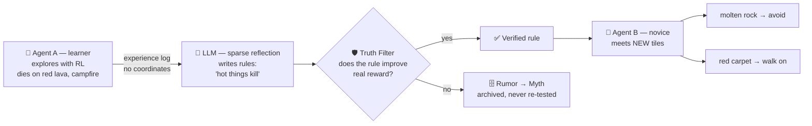
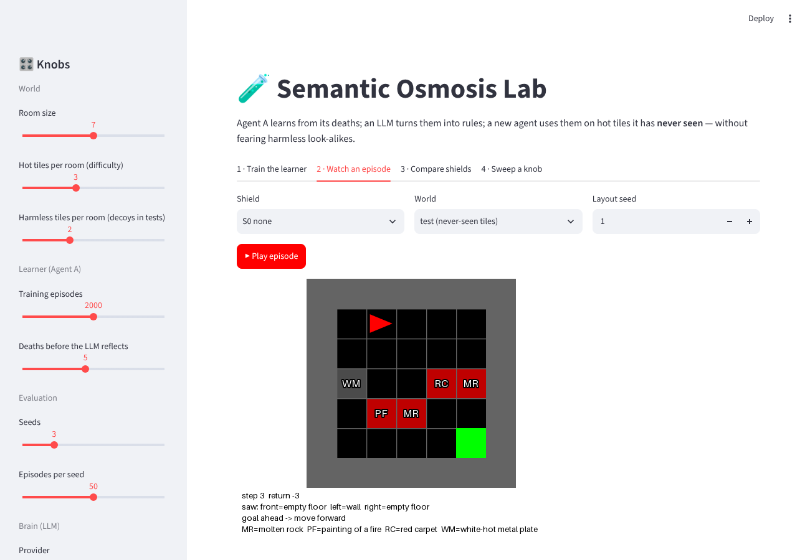

<div align="center">

# 🧠 Hybrid RL–LLM Explorer

### Semantic Osmosis — *one agent learns, every agent knows*

**Agents that learn from their own failures, turn them into human-readable rules,
verify those rules against reality, and hand them to new agents —
who then survive dangers nobody has ever seen.**


[Research plan](future_plan/future.md) ·
[Tracker](future_plan/tracker.md) ·
[Research idea](docs/research_idea.md) ·
[Glossary](docs/glossary.md) ·
[Live Lab](https://huggingface.co/spaces/ashyou09/hybrid-rl-llm-explorer)

</div>

---

## 📌 The problem

Today's AI agents are stuck between two bad options:

| Approach | Strength | Weakness |
|---|---|---|
| **Pure reinforcement learning** | Learns real lessons from real rewards | "Mute": shares numbers no one can read; every agent must repeat the same mistakes |
| **Pure LLM agents** | Can explain and share in plain language | **Hallucinates**: shares rules that sound right but are physically wrong |
| **Share everything** | Nothing is lost | Floods the network; does not scale |

**Our idea — Semantic Osmosis:** combine both. RL provides *ground truth*, the LLM
provides *meaning*, and a **Truth Filter** makes sure only rules that survive
contact with reality are shared.

## 🔬 The research question

> Can rules that an LLM writes from a learner agent's few deaths let a **new agent**
> avoid **never-seen hazards** on its first try — without avoiding **harmless
> look-alikes** — and can testing rules against reward stop **wrong rules** from spreading?

**Example.** Agent A dies on *red lava* and a *campfire*. The LLM writes the rule
*"hot things kill"*. Agent B has never seen *molten rock*, but avoids it — and still
walks across a *red carpet*, because a carpet is not hot.

## ⚙️ How it works



| Part | Role | Analogy |
|---|---|---|
| **RL agent** | Fast reflexes; learns from reward | The body |
| **LLM (sparse reflection)** | Wakes up only after failures; writes rules | The brain thinking things over |
| **Truth Filter** | Rules must prove themselves before use | A scientist testing a hypothesis |
| **Shield** | Blocks unsafe actions using verified rules | A safety guard |
| **Myth archive** | Keeps disproven rules so nobody re-tests them | A list of debunked myths |

## 🪜 Research plan: 6 levels, smallest first

Each level is a complete mini-project: a question, code, results, and two write-ups.

| Level | Name | Question | Status |
|---|---|---|---|
| **1** | **First Transfer** | Do rules from a few deaths protect a novice on never-seen hazards, without fearing look-alikes? | 🟨 built; LLM runs pending |
| 2 | Experience vs. Common Sense | When the world breaks common sense (water kills, fire is safe), does experience override the LLM? | ⬜ |
| 3 | The Truth Filter | Does testing rules against reward stop wrong or noisy rules? | ⬜ |
| 4 | When to Think | How often should the LLM be called; can a small model replace a big one? | ⬜ |
| 5 | Two Agents Share | Does verified sharing beat learning alone; does trust stop a lying agent? | ⬜ |
| 6 | The Village | Does it scale to many agents with limited bandwidth? | ⬜ |

➡️ Full detail: [future_plan/future.md](future_plan/future.md) ·
Live status: [future_plan/tracker.md](future_plan/tracker.md)

### What we compare (Level 1)

| Method | Decides "is this tile dangerous?" by… |
|---|---|
| No shield | never blocking |
| Exact lookup | "did this exact tile kill me before?" |
| Embedding retrieval | "does this text look similar to a killer?" (the v0 method) |
| LLM, no experience | common sense only |
| **LLM + experience (ours)** | common sense **and** what actually happened |
| Oracle | knowing the truth (upper limit) |

Measured over 10 seeds × 100 episodes, with 95% confidence intervals:
success rate, deaths on unseen hazards, decoys wrongly avoided, steps, LLM calls.

### 🧪 The Lab

A browser panel to **watch** the agent and **turn knobs** like a scientist: number of
hazards and decoys, how much the learner experienced, which LLM, how strict the
matching is. Every episode is replayed with the shield's reasoning under each frame.

**Online:** [huggingface.co/spaces/ashyou09/hybrid-rl-llm-explorer](https://huggingface.co/spaces/ashyou09/hybrid-rl-llm-explorer)
· **Locally:**

```bash
streamlit run lab.py
```



### 📊 First results (Level 1)

Novice agent in rooms with **never-seen** hot tiles (10 seeds × 100 episodes, 95% CI):

| Shield | Success | Deaths |
|---|---|---|
| None | 57.4% | 41.1% |
| Exact lookup of past killers | 57.4% | 41.1% |
| Oracle (perfect judgement) | 92.6% | 0.0% |
| LLM shields (Claude Haiku 5.5) | *pending: run once the API key is set* | |

Remembering exact failures gives **no** protection on new hazards; a shield with good
judgement is worth ~35 points of success. Details: [results/level_1/tables](results/level_1/tables/).

## 📁 Repository map

```
├── future_plan/        The plan: 6 levels, tracker, vision, review, decisions
├── conclusion/         Write-ups per level: paper.md (paper style) + explained.md (plain language)
├── docs/               Research idea, glossary, references, setup guide, v0 notes
├── research/           research code (python -m research --help)
├── results/            curated figures and tables
├── configs/            experiment settings (all knobs)
├── tests/              automated tests (pytest)
├── lab.py              the Lab panel (streamlit run lab.py) — runs on the Hugging Face Space
├── src/                v0 prototype code
├── run_experiment.py   v0 demo (desktop, Pygame)
└── app.py              v0 demo (web, Gradio)
```

## 🛠️ Tools

| Part | Choice | Why |
|---|---|---|
| Environment | Gymnasium + MiniGrid + text layer | Research standard; tiles get natural-language descriptions |
| RL | Tabular Q-learning | Honest RL, no GPU needed |
| LLM | Claude Haiku 5.5 (cheapest Claude model) | Reachable from the cloud session; a full Level 1 run costs well under one cent |
| Other LLMs | Groq / OpenRouter (open Llama models), Ollama offline | Supported for the Level 4 model comparison |
| Offline / backup | Ollama · OpenRouter | Run locally / alternative free models |
| Reference model | Claude (sparingly) | Model-size comparison in Level 4 |
| Visuals | GIF replays + Streamlit Lab | See what happens, change knobs |

Setup and API keys: [docs/setup.md](docs/setup.md)

## 🚀 The v0 prototype (local only)

The original prototype: an agent learns that red lava kills, a local LLM writes a
rule, and a second run uses the rule to avoid lava in new layouts. The Hugging Face
Space now runs the Lab instead; the prototype runs locally.
How it works: [docs/legacy_demo.md](docs/legacy_demo.md).

```bash
pip install -r requirements.txt
```

Desktop version (opens a Pygame window with a settings screen):

```bash
python run_experiment.py
```

Web version (needs `pip install gradio==5.50.0`):

```bash
python app.py
```

If [Ollama](https://ollama.com) is running with `llama3.2:3b`, the demo uses it;
otherwise a built-in fallback writes the rules.

> ℹ️ The v0 demo is a prototype. Its known limitations — and how the research plan
> fixes them — are listed in [future_plan/01_current_state_review.md](future_plan/01_current_state_review.md).

## 📏 Research principles

1. **Every number comes from a script in this repo**, with fixed seeds and the command shown.
2. **Expected results are hypotheses, not facts**, until measured.
3. **Failures are reported too** — a hypothesis that turns out false is a result.
4. **Only checked references** are cited ([docs/references.md](docs/references.md)).

How we work: [CONTRIBUTING.md](CONTRIBUTING.md)

## 👤 Author

**Ashutosh Singh** ([@ashyou09](https://github.com/ashyou09)) — research project in progress.
